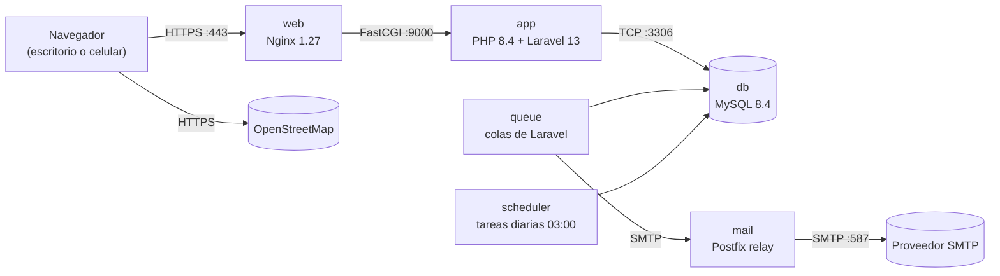

<div align="center">

# 🐾 AdoptaUY

**Plataforma web de adopción responsable de perros y gatos en Montevideo**

Proyecto final · Tecnicatura en Redes y Software · ITI CETP-UTU · Equipo **CodeCrafters** · 2026

[](https://github.com/CodeCraftersITI/adoptauy/actions/workflows/pruebas.yml)


</div>

---

## Índice

- [Qué es AdoptaUY](#qué-es-adoptauy)
- [Estado del proyecto](#estado-del-proyecto)
- [Funcionalidades](#funcionalidades)
- [Arquitectura](#arquitectura)
- [Puesta en marcha](#puesta-en-marcha)
- [Cómo trabajamos](#cómo-trabajamos)
- [Documentación](#documentación)
- [Estructura del repositorio](#estructura-del-repositorio)
- [Equipo](#equipo)

---

## Qué es AdoptaUY

En Montevideo, la información sobre animales en adopción y mascotas perdidas está dispersa en redes sociales y grupos de mensajería. AdoptaUY la reúne en un solo lugar:

- **Particulares y refugios** publican perros y gatos en adopción y mascotas perdidas.
- **Quien quiere adoptar** filtra por especie, raza, sexo, edad y fecha, y envía una solicitud al publicante.
- **Después de la adopción**, el sistema pide una foto del animal a los 15 días para verificar que esté bien.
- **Los refugios validados** aparecen en un mapa y publican su cuenta bancaria para recibir donaciones por transferencia. La plataforma no procesa pagos.
- **Un sistema de reportes** con umbrales automáticos y moderación del Administrador protege a la comunidad de publicaciones falsas y usuarios maliciosos.

> Es una aplicación web adaptable a escritorio y celular (desde 360 px). No hay app móvil nativa ni PWA.

## Estado del proyecto

| Hito | Fecha | Entregable | Estado |
|---|---|---|---|
| Hito 1 | 18/09/2026 | Documento integrador 1.0, prototipos, DER y topología de red | ✅ Entregado |
| Hito 2 | 23/10/2026 | Documento integrador 2.0 y primer incremento funcional | 🚧 En curso (Sprint 4) |
| Hito 3 | 20/11/2026 | Proyecto completo, probado y documentado | ⏳ Pendiente |

**Demo del Hito 2:** registro de Particular, inicio y cierre de sesión, página de inicio con el listado público, publicación de mascota en adopción y publicación de mascota perdida.

## Funcionalidades

| Módulo | Qué incluye | Requisitos | Hito |
|---|---|---|---|
| 👤 Usuarios y acceso | Registro de Particular con cédula válida, confirmación de correo, inicio y cierre de sesión, solicitud y validación de refugios | RF:0005, RF:0022, RF:0023, RF:0034, RF:0039, RF:0043, RF:0044 | 2 y 3 |
| 🐶 Publicaciones | Mascotas en adopción (1 a 6 fotos) y mascotas perdidas (1 a 3 fotos, vigencia de 30 días renovable), con filtros y cachorros (menos de 12 meses) | RF:0017 a RF:0021, RF:0024 a RF:0028, RF:0040, RF:0041, RF:0045 a RF:0048 | 2 y 3 |
| 🏠 Adopción y seguimiento | Solicitudes, rechazo, adopción definitiva, aviso del día 15 y restricción de la cuenta el día 22 si no se envía la foto | RF:0049 a RF:0052, RF:0054 a RF:0058 | 3 |
| 🗺️ Refugios y donaciones | Mapa de Montevideo (OpenStreetMap + Leaflet), perfil público y cuentas bancarias para transferencias | RF:0035 a RF:0038, RF:0042, RF:0062 | 3 |
| 🚩 Reportes y moderación | Reportes de publicaciones, particulares y refugios, con medidas automáticas por umbral | RF:0059 a RF:0061 | 3 |
| 🛡️ Administración | Gestión de publicaciones, particulares, refugios y reportes | RF:0001 a RF:0014, RF:0060 | 3 |
| ✉️ Notificaciones | Un correo por evento: registro, solicitud de refugio, alta de refugio, solicitud de adopción y aviso de seguimiento | RF:0063 | 3 |

El catálogo completo (57 requisitos funcionales vigentes y 14 no funcionales, con sus criterios de aceptación) está en [`docs/contexto/requisitos.md`](docs/contexto/requisitos.md).

## Arquitectura



Todos los servicios corren en contenedores Docker sobre una VM con **Ubuntu Server 24.04 LTS** (VirtualBox), alojada en un servidor local del equipo. En desarrollo, **Mailpit** captura los correos en lugar de Postfix. El diagrama de implementación completo está en [`docs/diagramas/`](docs/diagramas/AdoptaUY-Diagrama-de-implementacion.png).

| Capa | Tecnología |
|---|---|
| Backend | PHP 8.4 · Laravel 13 (MVC, Eloquent, colas y planificador) |
| Frontend | Blade · HTML5 · CSS3 · Leaflet |
| Base de datos | MySQL 8.4 (utf8mb4) |
| Servidor web | Nginx 1.27 con HTTPS |
| Infraestructura | Docker Compose · Ubuntu Server 24.04 · VirtualBox |
| Correo | Mailpit (desarrollo) · Postfix relay (producción) |
| Pruebas | PHPUnit · Laravel Dusk · GitHub Actions |

## Puesta en marcha

### Requisitos

- Una VM con **Ubuntu Server 24.04 LTS** (2 vCPU, 4 GB de RAM, 30 GB de disco).
- En VirtualBox, red **NAT** con reenvío de puertos `2222→22`, `8080→80`, `8443→443` y `8025→8025`.

### Instalación

```bash
# Desde la VM, con un usuario con sudo (no root)
git clone https://github.com/CodeCraftersITI/adoptauy.git
cd adoptauy
bash infra/setup.sh
```

El script instala Docker, configura el firewall, genera un certificado HTTPS autofirmado, crea el `.env` con contraseñas aleatorias, levanta los contenedores, ejecuta las migraciones y programa el respaldo diario.

| Servicio | URL desde la PC anfitriona |
|---|---|
| AdoptaUY | https://localhost:8443 |
| Correos de desarrollo (Mailpit) | http://localhost:8025 |
| SSH a la VM | `ssh -p 2222 usuario@localhost` |

### Comandos frecuentes

```bash
docker compose ps                                 # estado de los contenedores
docker compose exec app php artisan migrate       # migraciones
docker compose exec app php artisan test          # pruebas unitarias e integración
docker compose exec app php artisan dusk          # pruebas funcionales
docker compose logs -f web app queue              # logs
./scripts/respaldo.sh                             # respaldo manual
```

> ⚠️ El archivo `.env` contiene contraseñas y **nunca** se sube al repositorio.

## Cómo trabajamos

Scrum con seis sprints (dos por hito), backlog en Trello y revisión de código en GitHub.

1. Cada tarea de Trello tiene su rama: `feature/RF0039-registro`, `fix/…`, `docs/…`.
2. Los commits y los pull requests nombran los requisitos que cubren (`RF:0039`, `RNF:0013`).
3. Todo cambio entra a `main` por **pull request**, con la revisión de otro integrante y las pruebas en verde.
4. Los defectos se registran en la lista «Defectos» de Trello.
5. Los datos de prueba son siempre ficticios (Ley N.º 18.331 de Protección de Datos Personales).

## Documentación

| Documento | Contenido |
|---|---|
| [`docs/contexto/alcance.md`](docs/contexto/alcance.md) | Objetivos, alcance, hitos y decisiones del proyecto |
| [`docs/contexto/requisitos.md`](docs/contexto/requisitos.md) | Actores, requisitos funcionales y no funcionales |
| [`docs/contexto/reglas-negocio.md`](docs/contexto/reglas-negocio.md) | Estados, plazos, umbrales de reportes y notificaciones |
| [`docs/contexto/modelo-datos.md`](docs/contexto/modelo-datos.md) | DER, restricciones (RNE) y pasaje a tablas |
| [`docs/contexto/diseno-ui.md`](docs/contexto/diseno-ui.md) | Pantallas por actor y sistema de diseño |
| [`docs/contexto/infraestructura.md`](docs/contexto/infraestructura.md) | Red, servidores, servicios y entorno local |
| [`docs/contexto/plan-pruebas.md`](docs/contexto/plan-pruebas.md) | Estrategia de pruebas y casos CP-01 a CP-46 |

La fuente oficial es el **Documento integrador 2.0**; los archivos de `docs/contexto/` son extractos de ese documento.

## Estructura del repositorio

```
adoptauy/
├── .claude/rules/        # Reglas para Claude Code por área (base de datos, pruebas, vistas)
├── .github/workflows/    # Integración continua (PHPUnit sobre MySQL)
├── docs/
│   ├── contexto/         # Extractos del integrador 2.0 y del plan de pruebas
│   └── diagramas/        # Diagrama de implementación
├── infra/setup.sh        # Preparación de la VM y del entorno Docker
├── CLAUDE.md             # Contexto del proyecto para Claude Code
└── README.md
```

El código de la aplicación Laravel se incorpora en los próximos commits.

## Equipo

| Integrante | Rol |
|---|---|
| Camilo Blanco | Coordinador · Scrum Master · Base de datos |
| Leandro Estévez | Subcoordinador · Scrum Master · Documentación y pruebas |
| Iñaki Pérez | Desarrollo · Pruebas unitarias e integración |
| Rodrigo González | Desarrollo · Infraestructura y pruebas no funcionales |

**Product Owner:** Martín Viar, docente del ITI CETP-UTU.

---

<div align="center">
<sub>Proyecto académico · Instituto Tecnológico de Informática (CETP-UTU) · Montevideo, Uruguay · 2026</sub>
</div>
